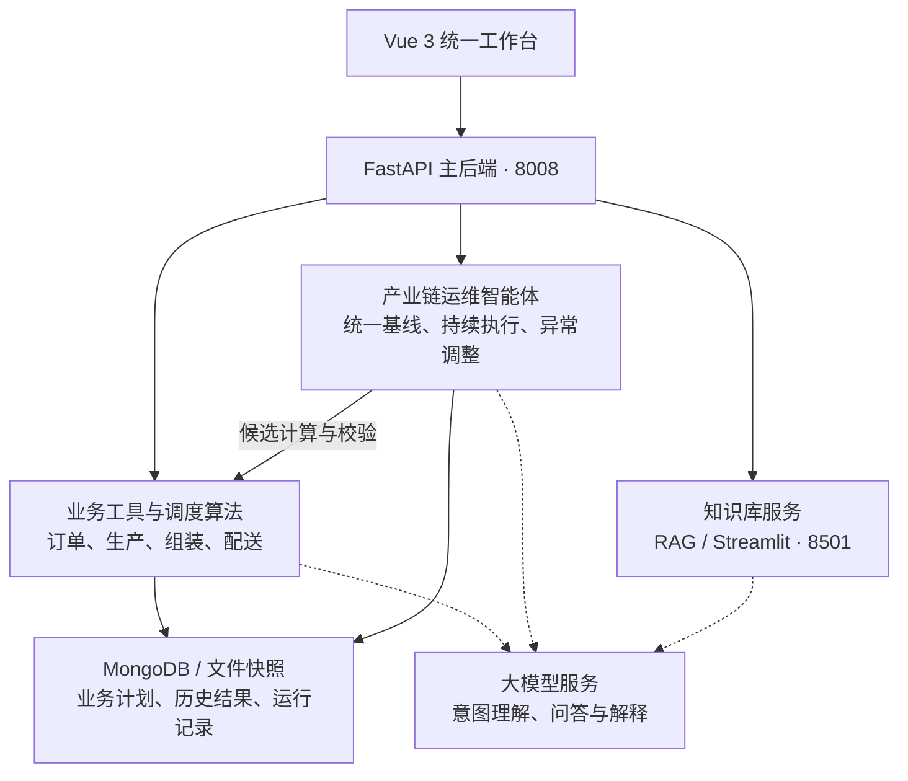

# 基于强化学习的产业链分布式资源适配与调度管控系统

面向生产、组装和配送的协同调度平台。各环节生成并保存计划，产业链运维智能体将关联结果汇成统一执行基线，持续跟踪运行变化，计算并校验调整方案。

## 启动

环境已安装时，在项目根目录打开 PowerShell：

```powershell
Start-Service MongoDB                             # 已运行可跳过；启动服务需要相应权限
cd .\tests
..\metaforge-test-env\Scripts\python.exe .\main.py  # 启动主后端及集成模块
```

打开 **http://127.0.0.1:8008/go**。保持终端运行，按 `Ctrl+C` 停止服务。首次安装与模型配置见[开发文档](docs/开发文档.md#setup)。

修改前端后，在项目根目录重新构建：

```powershell
cd .\frontend
npm run build                                    # 输出到后端托管目录
```

## 系统架构



供应链、组装和物流模块随主后端挂载；知识库问答由独立 Streamlit 进程提供。大模型辅助分析，具体排程由算法计算并校验。

## 功能介绍

| 功能 | 主要用途 |
|---|---|
| 产业链主控台 | 查看各环节状态及协同信息 |
| 供应链订单调度 | 订单录入、参数配置与产运优化 |
| 生产资源管控 | 多算法排程、方案对比、MES 仿真及设备、能耗、物料等资源管理 |
| 组装资源管控 | 组装排程、物料管理、甘特图、统计与动态演示 |
| 外协供应商管控 | 外购供给、供应商发运与到货衔接 |
| 物流资源管控 | 配送订单、多周期车辆路径优化、路线地图与结果分析 |
| 数据中心 | 查看、保存并复用生产、组装和配送结果，提供 test1、test2、test3 配套案例 |
| 产业链知识库 | 文档管理、检索与问答 |
| 产业链运维智能体 | 关联全链路计划、实时模拟、登记异常、大模型问答及调整方案确认 |

当前全链路运行属于真实时钟下的模拟执行。安装配置、代码结构、接口与能力边界统一见 **[开发文档](docs/开发文档.md)**。

## License

MIT
